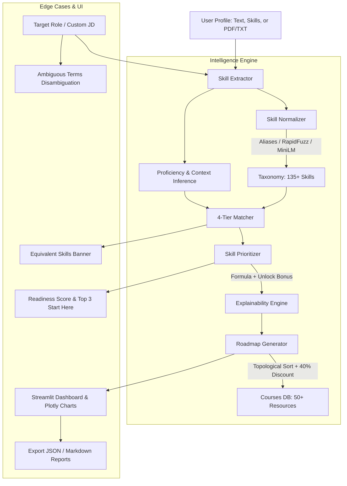

# ⚡ AI-Based Skill Gap Analyzer & Learning Roadmap Generator

**Team:** VORTEX4 | **Domain:** AI & ML | **Problem Statement:** 44

An intelligent, explainable, and offline-resilient skill gap analysis system. Instead of rigid keyword matching, this system normalizes messy terminology, distinguishes 4 tiers of competence (Existing, Level-mismatch, Equivalent experience, and Missing), mathematically prioritizes skill gaps based on importance and prerequisite unlocks, generates fact-based explanations for every recommendation, and formulates topologically sorted learning roadmaps.

---

## 🌟 Key Features

1. **Robust 3-Tier Normalization:**
   - **Tier 1:** Exact canonical and alias lookup table (e.g. `sklearn` $\to$ `scikit-learn`, `ReactJS` $\to$ `React`, `k8s` $\to$ `Kubernetes`).
   - **Tier 2:** RapidFuzz token set ratio ($\ge 90$) handles typos and casing.
   - **Tier 3:** Sentence-Transformers semantic cosine similarity ($\ge 0.80$) with graceful offline fallback.
2. **Context-Aware Proficiency & JD Extraction:**
   - Extracts skills from unstructured resumes, free-text paragraphs, or uploaded `.txt`/`.pdf` documents.
   - Infers candidate experience levels (`beginner`, `intermediate`, `advanced`) based on linguistic context markers (e.g. *"built"*, *"production"* $\to$ advanced; *"basic"*, *"coursework"* $\to$ beginner).
   - Ingests custom pasted Job Descriptions and identifies mandatory vs preferred requirements.
3. **4-Tier Competency Classification:**
   - **`EXISTING` (Score 1.0):** Candidate meets or exceeds the required level.
   - **`PARTIAL (level)` (Score 0.5 – 0.8):** Candidate possesses the skill but below the target seniority.
   - **`PARTIAL (equivalent)` (Score capped at 0.85):** Candidate has transferable background in a related tool (e.g. *TensorFlow* $\to$ *PyTorch* or *matplotlib* $\to$ *Data Visualization*).
   - **`MISSING` (Score 0.0):** Candidate lacks background in this competency.
4. **Mathematical Prioritization & Factual Explanations:**
   - Evaluates gap distance, mandatory weight multiplier ($1.5\times$), and prerequisite unlock bonuses so foundational skills rank higher.
   - Every single recommendation generates a factual *"why"* sentence explaining importance, current baseline, and downstream unlocks.
5. **Topological Learning Roadmap with Synergy Discounts:**
   - Orders learning steps strictly by prerequisites (e.g. *Statistics* before *Machine Learning* before *PyTorch*).
   - Groups into Phase 1 (Foundations), Phase 2 (Core Role Skills), and Phase 3 (Specializations).
   - Applies an automatic **40% time discount** for equivalent skills.
6. **Built-in Handling for Real-World Edge Cases:**
   - **Equivalent Experience Synergy:** Visual banner alerting candidates that alternative experience is credited.
   - **Ambiguous Requirements:** Detects vague phrases like *"cloud knowledge"* and offers interactive checkbox disambiguation.
   - **Multiple Mandatory Missing Skills:** Calculates role Readiness Score and synthesizes a focused **"Start Here" Top 3** action list.
   - **Input Validation:** Friendly feedback for empty, brief, or unrecognized inputs with *"Did you mean?"* suggestions.
   - **Multi-Role Benchmarking:** Evaluates one profile across all 10 roles simultaneously.

---

## 🏛️ System Architecture



---

## 📐 Scoring & Prioritization Methodology

### 1. Gap Calculation
$$\text{Gap} = 1.0 - \text{Match Score}$$

### 2. Priority Scoring Formula
$$\text{Priority} = \left(\text{Importance} \times \text{Gap} \times (1.5 \text{ if mandatory else } 1.0)\right) + (0.1 \times \text{Unlock Bonus})$$

- **$\text{Unlock Bonus} \in [0.0, 1.0]$:** Proportional to the number of remaining gaps that require this skill as a prerequisite. This guarantees foundations (like *Statistics* or *SQL*) rank above specialized leaf topics.
- **Priority Buckets:**
  - $\text{Priority} \ge 0.70 \implies \mathbf{HIGH}$
  - $0.35 \le \text{Priority} < 0.70 \implies \mathbf{MEDIUM}$
  - $\text{Priority} < 0.35 \implies \mathbf{LOW}$

### 3. Readiness Score & Verdict
$$\text{Readiness Score} = \frac{\sum (\text{Match Score} \times \text{Importance})}{\sum \text{Importance}} \times 100\% \quad (\text{over mandatory skills})$$

- $\ge 80\% \implies \textbf{Ready}$
- $50\% - 79\% \implies \textbf{Almost there}$
- $< 50\% \implies \textbf{Needs foundation}$

---

## 📁 Repository Structure

```
skill-gap-analyzer/
├── app.py                      # Interactive Streamlit Web Interface
├── requirements.txt            # Project dependencies
├── README.md                   # System documentation & setup guide
├── data/
│   ├── skills_taxonomy.json    # 135+ canonical skills, aliases, categories, prereqs, relations
│   ├── roles.json              # 10 industry roles with importance, mandatory, & level
│   └── courses.json            # Free courses, official docs, books, & hour estimates
├── src/
│   ├── __init__.py
│   ├── normalizer.py           # Multi-tier alias, fuzzy, and embedding normalizer
│   ├── extractor.py            # PhraseMatcher, regex, proficiency inference, & JD parser
│   ├── matcher.py              # 4-tier match classifier (Existing, Level, Equivalent, Missing)
│   ├── prioritizer.py          # Mathematical priority score calculation & unlock bonus
│   ├── explainer.py            # Fact-based "why" explanation generator
│   ├── roadmap.py              # Topological sorting, 3-phase planner, hours & week estimation
│   ├── edge_cases.py           # Ambiguity, equivalent banners, readiness score, validation
│   └── pipeline.py             # Master orchestrator & report exporter
├── tests/
│   └── test_pipeline.py        # Complete automated pytest test suite
└── demo/
    ├── sample_profile.txt      # Canonical test candidate profile
    └── demo_script.md          # 3-minute presentation script
```

---

## 🚀 Setup & Execution Guide

### Prerequisites
- Python 3.11 or Python 3.12
- Git

### Installation
```bash
# Clone the repository
git clone https://github.com/vortex4/skill-gap-analyzer.git
cd skill-gap-analyzer

# Create and activate virtual environment
python -m venv .venv

# Windows:
.venv\Scripts\activate
# Linux / macOS:
source .venv/bin/activate

# Install dependencies
pip install -r requirements.txt

# (Optional) Download spaCy English model (system gracefully falls back if omitted):
python -m spacy download en_core_web_sm
```

### Running Tests
Execute the automated test suite verifying all normalization, scoring, edge cases, and roadmap logic:
```bash
pytest -v
```

### Launching the Streamlit Application
```bash
streamlit run app.py
```
Open your browser at `http://localhost:8501`.

---

## 🧪 Verified Demo Scenario

**Profile:** `demo/sample_profile.txt`  
> *"Final-year CS student. Built projects in Python using pandas, numpy, matplotlib and sklearn. Know basic SQL from coursework. Completed a TensorFlow image classifier. Familiar with Git and Streamlit."*

**Target Role:** `Data Scientist`

| Skill | Required Level | Detected Status | Match Score | Explanation Fact |
|---|---|---|---|---|
| **Python** | Advanced | `EXISTING` | 100% | Directly possessed at advanced level from project builds. |
| **scikit-learn** | Intermediate | `EXISTING` | 100% | Normalized from alias `sklearn`. |
| **SQL** | Intermediate | `PARTIAL (level)` | 65% | User has basic coursework experience vs intermediate required. |
| **Deep Learning** | Beginner | `PARTIAL (equivalent)` | 75% | User built TensorFlow classifier; 40% time discount applied. |
| **Statistics** | Intermediate | `MISSING` | 0% | HIGH priority, mandatory, unlocks downstream topics. |

- **Top "Start Here" Recommendations:** `Statistics` $\to$ `SQL` $\to$ `Deep Learning`
- **Readiness Score:** 67.5% (`Almost there`)

---

## ⚠️ Limitations & Future Work

1. **LLM-Based Extraction (Stretch):**
   - *Current:* Rule-based spaCy PhraseMatcher and RapidFuzz provide deterministic, ultra-fast, zero-cost offline matching.
   - *Future:* Optional LLM integration (OpenAI/Anthropic/Gemini) for nuanced semantic understanding of complex project paragraphs.
2. **Real-Time Job Scraping:**
   - *Current:* Ingests pasted job descriptions and pre-configured role databases.
   - *Future:* Live scraping of LinkedIn/Indeed job postings to aggregate real-time industry demand weights.
3. **Learner Progress Tracking:**
   - *Current:* Generates static phased roadmaps.
   - *Future:* User accounts, course completion checkboxes, and dynamic readiness score updates as learners finish modules.
